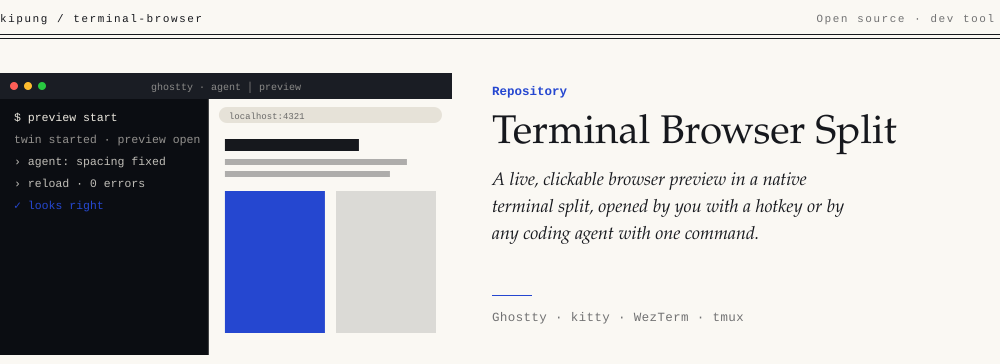
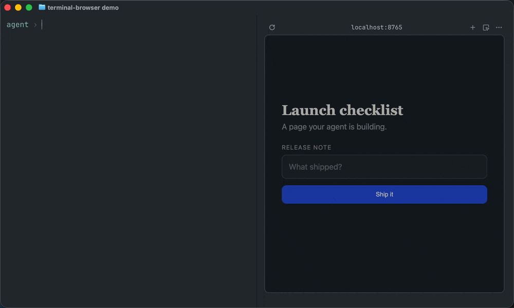

<picture><source media="(max-width: 640px)" srcset=".github/banner-m-light.svg"><source media="(prefers-color-scheme: dark)" srcset=".github/banner-dark.svg"></picture>

**A live, clickable browser preview beside your terminal agents — at full speed,
opened by you with one hotkey or by any agent with one command.**
macOS and Linux · Ghostty, kitty, WezTerm, tmux.

<p align="center"></p>

> **Not to be confused with [terminal-browser](https://terminal-browser.dev) itself** —
> this repo packages that excellent tool into your terminal workflow: it renders
> *inside a native terminal split* so agents can show you live pages without the
> multiplexer graphics frame-flood. Think "addon", not "fork".

If you run coding agents in a terminal multiplexer and you've wished they could just…
*show you the page* they're working on — that's this. `terminal-browser` renders a real
browser inside a terminal pane (kitty graphics protocol). This addon wires it into your
terminal's **native split** — side by side with your agents — with a hotkey for humans
and a one-command opener for agents.

```
┌─────────────────────────────┬───────────────────┐
│  herdr / tmux               │                   │
│  ┌──────────┬────────────┐  │   browser preview │
│  │ agent 1  │  agent 2   │  │   localhost:3000  │
│  │ streaming│ streaming  │  │   live, clickable │
│  └──────────┴────────────┘  │                   │
└─────────────────────────────┴───────────────────┘
     one hotkey (see table) — or the agent does it
```

## Why a *native terminal* split and not a multiplexer pane?

Some multiplexers (notably [herdr](https://herdr.dev)) re-emit their entire pane scene —
including any kitty graphics they host — to the host terminal on **every text frame**.
Put a browser inside such a pane next to a streaming agent and the terminal emulator
pins a CPU core, memory balloons by hundreds of MB, and the whole session goes laggy.

A native split (of Ghostty/kitty/WezTerm itself) lives *outside* the multiplexer's
compositing: the terminal renders the graphics directly, the multiplexer never sees
them, and everything stays fast. This addon is that split-plus-launch flow, packaged
per terminal.

## Supported terminals

| Terminal | Platform | Human hotkey | What it does | Agent path from inside a multiplexer |
|---|---|---|---|---|
| **Ghostty** | macOS + Linux | split (`Cmd/Super+D`), then `Super/Cmd+Shift+N` | types the command into the focused split¹ | AppleScript keystrokes (macOS; needs Accessibility for Ghostty) |
| **kitty** | macOS + Linux | `Ctrl+Shift+N` — one press² | opens browser directly in a new split | `kitty @ launch` (needs `allow_remote_control = yes`) |
| **WezTerm** | macOS + Linux | `Ctrl+Shift+N` — one press² | opens browser directly in a new split | `wezterm cli split-pane` + `send-text` |
| **tmux** | macOS + Linux | `<prefix> n` | opens browser in a new right split | tmux supports `--split` natively; also inherits the host terminal's path |
| VS Code | any | — | `open-preview.sh` works (terminal-browser supports its terminal) | `--split` is correct here |

¹ Ghostty 1.3.x can't chain actions onto `new_split` (`new_split:right,text:…` →
InvalidFormat), so launching is its own keybind. If chaining lands upstream, one key
will be enough. In Ghostty, `super` and `cmd` are aliases for the same modifier —
Command on macOS, Super on Linux.
² kitty and WezTerm *can* chain, so their hotkey opens the split **and** runs the
browser in one press.

## Requirements

- One of: **Ghostty 1.3+**, **kitty**, **WezTerm**, **tmux** — on macOS or Linux
- [terminal-browser](https://terminal-browser.dev) — macOS: `brew install --cask terminal-browser`
- Optional, per agent path: macOS Accessibility permission for Ghostty;
  `allow_remote_control = yes` for kitty. **WezTerm needs nothing extra** — its CLI
  is the most agent-friendly route.

## Install

```sh
git clone https://github.com/Kipung/terminal-browser
cd terminal-browser
./install.sh            # auto-detects installed terminals
./install.sh --only kitty,tmux   # or pick explicitly; --all forces all
```

Each terminal's config gets **one marker-commented line** pointing into this repo,
so the keybind snippets in `configs/` stay live-editable:

```
# terminal-browser addon (ghostty)
config-file = /path/to/terminal-browser/configs/ghostty.conf
```

Edit the URL baked into each snippet in `configs/` (agent path uses `addon.conf`).
Uninstall with `./uninstall.sh` — removes only the marked lines; idempotent both ways.

## Usage

### As a human

Dev server up, then use the hotkey from the table above. Click and scroll the page
normally. Quit the browser with `q` (or Ctrl+C).

### As an agent

```sh
./open-preview.sh                       # URL from addon.conf
./open-preview.sh http://localhost:3000/pricing
```

It detects your host terminal and picks the fastest native route:

| Context | What happens |
|---|---|
| Not in a flood-prone multiplexer | `terminal-browser open --split right` — the tool itself asks your host for a native pane. Correct everywhere, no injection. |
| Inside herdr + **WezTerm** host | `wezterm cli split-pane` + `send-text` into the new pane. No permissions needed. |
| Inside herdr + **kitty** host | `kitty @ launch --type=split …` (remote control must be on). |
| Inside herdr + **Ghostty** host | macOS: AppleScript presses the split key + types the command. Linux: prints the manual keypress flow (Ghostty has no CLI split yet). |
| Detection fails | prints the manual flow instead of failing silently. |

Add a line to your project's `AGENTS.md` / `CLAUDE.md`:

> To show a live preview, run `path/to/open-preview.sh [url]`. Never launch
> `terminal-browser` directly from a multiplexer pane — its `--split` creates a pane
> *inside* the multiplexer, which re-triggers the graphics frame flood.

## Files

| File | Purpose |
|---|---|
| `addon.conf` | Default URL for the agent path |
| `configs/ghostty.conf` | Ghostty keybind (macOS + Linux) |
| `configs/kitty.conf` | kitty one-press map |
| `configs/wezterm-addon.lua` | WezTerm config module (one-press) |
| `configs/tmux.conf` | tmux `<prefix> n` binding |
| `open-preview.sh` | Agent-callable opener (host-aware) |
| `install.sh` / `uninstall.sh` | Wire/unwire one marked line per terminal |

## Troubleshooting

- **Hotkey does nothing** — reload config: Ghostty `Cmd/Ctrl+Shift+,`, kitty
  `Ctrl+Shift+F5`, tmux `:source ~/.tmux.conf`, WezTerm auto.
- **Ghostty agent path fails (osascript error)** — grant Ghostty Accessibility
  permission (macOS only path).
- **kitty agent path fails** — add `allow_remote_control = yes` to kitty.conf.
- **Browser feels sluggish** — check `~/.config/terminal-browser/settings.json`; a
  `"render.fps"` cap applies only at browser start. Keep it `{}` and restart the browser.
- **CPU pegged / memory ballooning** — a graphics surface ended up inside your
  multiplexer. Close the browser pane (`q`) and it heals instantly; make sure agents
  use `open-preview.sh`, not raw `terminal-browser`.
- **Memory creeping with many previews** — each instance costs ~150 MB;
  `terminal-browser ls --all` lists them, `q` closes one, `shutdown` stops all.

## Notes & upstream

- This is a workaround, not a fix: the frame flood is an upstream multiplexer issue
  around re-emitting graphics scenes per text frame. When hosts expose scriptable
  native splits (Ghostty CLI has no split action yet; WezTerm already does), the
  keystroke-injection paths can go away.
- terminal-browser ships its own agent skills (`terminal-browser setup`). Inside a
  herdr-style multiplexer, be careful: its skill teaches `--split`, which is the trap
  described above.

## License

MIT — see [LICENSE](LICENSE).
